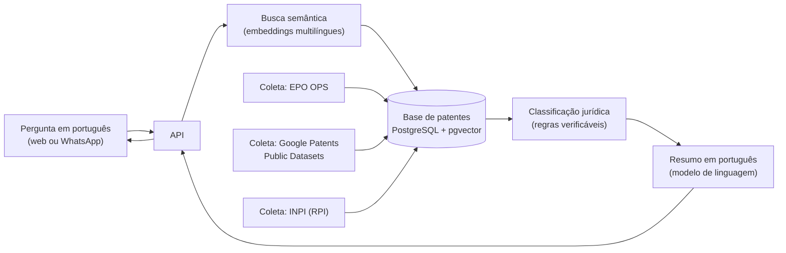

# Livre Aqui

**IA que aproxima pessoas com deficiência de tecnologias assistivas que já podem ser fabricadas no Brasil, de graça e legalmente.**

> **Status:** em planejamento. Projeto inscrito no programa AI4Good da Brazil Conference 2027 (tema: *IA que aproxima*). Este repositório documenta o objetivo e a arquitetura planejada; o código será desenvolvido em público, a partir de novembro de 2026.

---

## O problema

O Brasil tem 14,4 milhões de pessoas com deficiência, e 45,4% delas têm 60 anos ou mais (IBGE, Censo 2022). Para muitas, autonomia depende de tecnologia assistiva, como talheres adaptados, engrossadores de lápis e auxílios para segurar objetos. O preço ainda é uma barreira de acesso.

Ao mesmo tempo, **patentes só valem no país onde foram registradas e por tempo limitado**. Muitas tecnologias assistivas foram patenteadas apenas no exterior ou já expiraram, e podem ser fabricadas legalmente no Brasil. Essa informação, porém, está em documentos técnicos, em outros idiomas, e não chega a quem poderia produzir: institutos federais, laboratórios maker, terapeutas ocupacionais e centros de reabilitação.

## O que o Livre Aqui faz

1. A pessoa descreve uma necessidade em português comum, pela web ou pelo WhatsApp.
   *Ex.: "adaptação para uma pessoa com pouca força nas mãos conseguir segurar o talher".*
2. O sistema busca patentes relevantes no mundo todo, pelo significado da pergunta.
3. Regras jurídicas explícitas classificam cada tecnologia como **livre**, **protegida** ou **incerta** no Brasil.
4. A resposta traz uma explicação simples (o que é, materiais, nível de dificuldade) e o link do documento original.

## Arquitetura planejada



| Componente | Função | Tecnologia planejada |
|---|---|---|
| Coleta | Dados bibliográficos, famílias de patentes e eventos legais | EPO Open Patent Services (OPS), Google Patents Public Datasets (BigQuery), Revista da Propriedade Industrial (INPI) |
| Base | Patentes, famílias, situação no Brasil e vetores de busca | PostgreSQL + pgvector |
| Busca | Encontrar patentes pelo significado, em vários idiomas | Modelo de embeddings multilíngue (ex.: família E5 multilíngue) |
| Classificação | Decidir livre / protegida / incerta | Regras em Python, testadas e auditáveis |
| Resumos | Explicar cada patente em português simples, sempre citando a fonte | Modelo de linguagem, com saída ancorada no documento original |
| Interfaces | Chat web e WhatsApp | API em FastAPI; WhatsApp Business Platform |

*A stack pode mudar durante o desenvolvimento.*

## Regras de classificação (primeira versão)

A IA **não** decide a situação jurídica. A decisão é tomada por regras explícitas, com conferência humana por amostragem:

- **Protegida:** existe pedido ou patente brasileira da mesma família, pendente ou em vigor.
- **Livre:** não há membro brasileiro da família e o prazo de entrada no Brasil já terminou (12 meses da prioridade pela Convenção de Paris, ou 30 meses pelo PCT). Também é livre quando a patente brasileira expirou (20 anos do depósito para invenção, 15 para modelo de utilidade) ou foi extinta por falta de pagamento das anuidades.
- **Incerta:** prazo de entrada no Brasil ainda aberto, dados incompletos ou situação no INPI não confirmada.

Itens que podem exigir registro na Anvisa (como próteses e algumas órteses) são sinalizados. O foco inicial são **produtos de apoio de baixo risco** para atividades do dia a dia.

## Estrutura planejada do repositório

```
livre-aqui/
├── coleta/          # scripts de coleta (OPS, BigQuery, INPI)
├── classificacao/   # regras jurídicas e testes
├── busca/           # embeddings e busca semântica
├── resumos/         # geração de resumos em português
├── api/             # API (FastAPI)
├── chat/            # interface web e integração com WhatsApp
├── validacao/       # amostras conferidas à mão e métricas
├── docs/            # documentação
├── LICENSE
└── README.md
```

## Roadmap

- [ ] **Nov/2026:** base piloto de patentes de produtos de apoio e primeira versão das regras de classificação
- [ ] **Dez/2026:** busca semântica, resumos em português, chat e primeiros testes com usuários (Demo Day AI4Good: 20/12/2026)
- [ ] **Jan–mar/2027:** validação com terapeutas ocupacionais e protótipo impresso em 3D a partir de uma patente livre
- [ ] **Abr–jun/2027:** catálogo público em linguagem simples e artigo científico com os resultados

## Métricas

- Número de tecnologias assistivas livres no Brasil identificadas
- Taxa de acerto da classificação, medida em amostra conferida à mão
- Economia estimada por item em relação a produtos equivalentes vendidos no Brasil
- Número de organizações que testarem a ferramenta

## Limitações e aviso

- O Livre Aqui **orienta, mas não substitui parecer jurídico**. Antes de fabricar em escala, confirme a situação com um núcleo de inovação tecnológica ou um advogado.
- Ser livre no Brasil não autoriza exportar para países onde a patente está em vigor.
- Uma patente nem sempre traz todos os detalhes necessários para reproduzir a invenção.
- Resumos gerados por IA podem conter erros; toda resposta cita o documento original.

## Equipe

- **MAITÊ PEREIRA DA COSTA GÓS FERRAZ**: pesquisadora em propriedade intelectual. Regras de classificação, validação e contato com usuários.
- **LUCCA HORVATH DE LIMA TOMBINI**: desenvolvedor de sistemas. Coleta de dados, IA, API e chatbot.

## Como contribuir

O projeto é de código aberto. Sugestões, issues e pull requests são bem-vindos, principalmente de profissionais de reabilitação, makers e pesquisadores de propriedade intelectual.

## Licença

Distribuído sob a licença MIT. Veja o arquivo [LICENSE](LICENSE).
